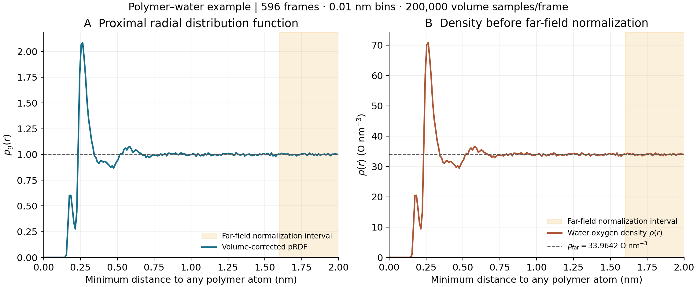

# gmx pgr

**体积修正的 proximal radial distribution function（pRDF，近邻径向分布函数）分析工具。**

A C++ GROMACS extension for the volume-corrected proximal RDF of water oxygen atoms around an entire polymer, normalized by the far-field oxygen number density.

将整个 polymer 作为一个整体，对每个水分子的氧原子计算到 polymer **所有选中原子中最近原子**的周期性距离，按该距离统计水氧数密度，再除以指定远端区间的密度。

- 输入：GROMACS 轨迹（XTC、TRR、GRO 等）、TPR/GRO 结构文件及可选 index。
- 输出：无量纲 `pg(r)` 曲线，以及体积、密度、计数和采样命中数。
- 使用 GROMACS 原生选择、轨迹读取和周期邻域搜索接口；生产计算无需 Python。
- 已验证：**Linux / GROMACS 2025.3 / mixed precision**。这是独立扩展项目，不是 GROMACS 官方内置命令。

## 示例图



左图：体积修正并按远端密度归一化后的 `pg(r)`；右图：归一化前的氧数密度。阴影为远端归一化区间 **[1.6, 2.0) nm**，虚线分别为 1 和远端密度。

该图来自实际 polymer–water 轨迹的 **596 帧**（0–29750 ps，间隔 50 ps），包含 235 个 target 原子和 6954 个水氧；`-bin 0.01 -rmax 2 -samples 200000 -seed 2026`。远端密度为 **33.9642034 O/nm³**。曲线未平滑，未绘制误差条；相邻帧相关性和 Monte Carlo 体积误差需另行评估。

[曲线数据](docs/data/example_pgr.xvg) · [密度与采样数据](docs/data/example_pgr_density.xvg) · [SVG 矢量图](docs/images/example-pgr.svg) · [绘图脚本](scripts/plot_example.py)

原始研究轨迹未随仓库分发；以上计算后的数据足以重绘图像。仓库另附独立的合成坐标示例用于试运行，不能用该合成示例复现上图的物理曲线。

## 1. pRDF 的明确定义

### 最近距离：每个水氧只计一次

令 $P$ 为第一组中整个 polymer 的原子集合，$W$ 为第二组筛出的水氧集合。对于第 $t$ 帧中的水氧 $i$：

$$
d_i(t)=\min_{j\in P}\;\min_{\mathbf n\in\mathbb Z^3}
\left\|\mathbf r_{O_i}(t)-\mathbf r_j(t)+\mathbf H_t\mathbf n\right\|.
$$

其中 $\mathbf H_t$ 的列为盒矢量，$\mathbf n$ 枚举周期像。实现使用 GROMACS 的三维周期边界搜索，支持合法的三斜盒。

**整个第一组一起取最小值**，包括所选全部链；每个水氧在每帧最多进入一个 bin。距离为原子中心间距离，不扣除范德华半径，不采用 polymer 质心，也不把各原子普通 RDF 求平均。

### Proximal 壳层体积

第 $k$ 个 bin 为 $B_k=[r_k,r_{k+1})$，水氧计数为：

$$
N_{tk}=\sum_{i\in W}\mathbf 1\{d_i(t)\in B_k\}.
$$

对应的壳层是盒内到整个 polymer 最近距离落入该 bin 的所有空间点：

$$
V_{tk}=\int_{\Omega_t}\mathbf 1\{d(\mathbf x,P_t)\in B_k\}\,\mathrm d\mathbf x.
$$

这个区域通常不是球壳，因此不能直接用 $4\pi r^2\Delta r$ 归一化。

程序每帧在整个周期盒内均匀独立采样 $M$ 个随机点，计算同样的最近距离。若其中 $H_{tk}$ 个点命中该 bin，则估计：

$$
\widehat V_{tk}=|\det\mathbf H_t|\frac{H_{tk}}{M},\qquad
\widehat\rho_k=\frac{\sum_t N_{tk}}{\sum_t\widehat V_{tk}}.
$$

这是跨帧计数与体积之和的比值，适用于变化盒体积的 NPT 轨迹；不是每帧密度的简单算术平均。

### 远端密度归一化

用户指定远端区间 $B_{\mathrm{far}}=[r_a,r_b)$，同样直接统计该区间的水氧数和采样体积：

$$
\widehat\rho_{\mathrm{far}}=
\frac{\sum_t N_{t,\mathrm{far}}}{\sum_t\widehat V_{t,\mathrm{far}}},
\qquad
p_g(r_k)=\frac{\widehat\rho_k}{\widehat\rho_{\mathrm{far}}}.
$$

远端边界无需和 bin 边界对齐。默认区间为 `[0.8*rmax, rmax)`，并非自动检测体相区。应检查密度平台并测试区间敏感性；若全盒都受 polymer 影响，这只是指定远端区域的归一化，而非真正体相水。

## 2. 编译

需要 Linux、C++17 编译器、CMake ≥3.18、GROMACS 2025.3 mixed-precision 动态库，以及与动态库版本匹配的分析头文件或源码。

```bash
git clone https://github.com/1WaterMiu/gmx_pgr.git
cd gmx_pgr

cmake -S . -B build \
  -DGROMACS_PREFIX=/path/to/gromacs-install \
  -DGROMACS_SOURCE=/path/to/gromacs-2025.3-source
cmake --build build -j 4
source ./activate.sh

gmx pgr -h
```

`GROMACS_PREFIX` 中应有 `bin/gmx` 和 `lib/libgromacs.so`（也支持 `lib64`）。如果原有 `gmx` 已在 PATH 中，可省略该参数。若安装目录已经包含分析开发头文件，可省略 `GROMACS_SOURCE`；否则须提供**相同版本**的源码树。CMake 会拒绝 double precision，其他 GROMACS 版本未保证兼容。

生成的 `bin/gmx` 为项目入口：`pgr` 通过 GROMACS 原生分析模块注册，其他子命令转交编译时指定的原 GROMACS。`source activate.sh` 只修改当前 Bash 会话的 PATH，不替换系统安装，也不修改 shell 配置。也可直接用 `./bin/gmx pgr ...`。更换安装位置后需重新编译。

## 3. 输入与选择

典型运行：

```bash
gmx pgr -f traj_comp.xtc -s topol.tpr \
  -n index.ndx -sel -bin 0.01 -o pgr.xvg
```

程序提示输入两次选择：

1. **整个 polymer 的原子组**：包含希望纳入距离定义的全部原子，例如所有聚合物链和其氢原子。
2. **水组**：可选择含 O/H 的完整 Water/SOL 组，程序自动只保留氧原子。

非交互选择使用两个表达式，以分号分隔：

```bash
gmx pgr -f traj_comp.xtc -s conf.gro -n index.ndx \
  -sel 'group "Polymer"; group "Water"' \
  -bin 0.01 -rmax 2.0 -bulk-start 1.6 -bulk-end 2.0 \
  -samples 200000 -seed 2026 -o pgr.xvg
```

组名由你自己的 index 决定，也可用 `group 2; group 4` 等编号。仅接受静态原子选择。

| 输入 | 说明 |
|---|---|
| `-f` | 轨迹或单帧坐标，使用 GROMACS 支持的格式，例如 `.xtc`、`.trr`、`.gro` |
| `-s` | `.tpr` 或 `.gro` 等结构信息；GRO 提供此分析需要的原子/残基信息，但不是完整力场拓扑 |
| `-n` | 可选 `.ndx` 文件，在默认组之外提供自定义组 |
| `-sel` | 恰好两组：target/polymer，然后 water |

氧优先通过原子序数 8 识别；缺少元素信息时使用 O/o 开头的名字（如 OW、OH2）。第二组应为水，不能期望自动区分非水分子。每个选中残基最多允许一个氧；若水氧与 target 重叠、一个残基有多个氧或未找到氧，程序报错。无元素信息且使用非标准氧名称时，需要先规范原子名。

轨迹原子与结构原子必须正确对应；仅有部分原子的轨迹应按 GROMACS 的 `-fgroup` 语义显式指定映射。默认启用 PBC，`-nopbc` 不支持。

## 4. 参数

| 参数 | 默认值 | 说明 |
|---|---:|---|
| `-o` | `pgr.xvg` | 归一化曲线文件 |
| `-bin` | 0.01 | 距离 bin 宽度，nm |
| `-rmax` | 2.0 | 分析距离上限，nm，右端不包含 |
| `-bulk-start` | 0.8 × rmax | 远端区间左端，nm |
| `-bulk-end` | rmax | 远端区间右端，nm，右端不包含 |
| `-samples` | 200000 | 每帧用于体积估计的随机点数 |
| `-seed` | 2026 | 随机数种子 |
| `-b` / `-e` | GROMACS 默认 | 起始/结束时间，默认单位 ps |
| `-dt` | GROMACS 默认 | 选取帧的时间间隔，默认单位 ps |

要求 `0 < bin <= rmax`，`0 <= bulk-start < bulk-end <= rmax`。最后一个 bin 在 rmax 处截断，输出实际区间中点。rmax 以外的水氧不会进入曲线，日志报告被截去的观察次数。

## 5. 输出

`pgr.xvg`：

```text
# r_nm pg
0.005  ...
0.015  ...
```

| 列 | 含义 | 单位 |
|---|---|---|
| 1 | 最近距离 bin 中点 | nm |
| 2 | 体积修正后、按远端密度归一化的 pRDF | 无量纲 |

同时生成 `pgr_density.xvg`（文件名随 `-o` 变化）：

```text
# r_nm rho_O_nm-3 volume_sum_nm3 water_count MC_hits
```

| 列 | 含义 |
|---|---|
| 1 | bin 中点，nm |
| 2 | 归一化前的水氧数密度，O/nm³ |
| 3 | 各帧采样壳层体积之和，nm³；除以帧数得到平均体积 |
| 4 | 各帧水氧命中计数之和 |
| 5 | 各帧随机采样点命中计数之和 |

文件头记录帧数、samples、seed、远端区间、远端密度及其计数/体积。输出使用 XVG 文本格式；这两个自定义输出始终保留注释和图形头，不根据框架继承的 `-xvg` 选项切换格式。NumPy 可用 `np.loadtxt(path, comments=('#', '@'))` 读取。

**采样体积为零的 bin 输出 NaN**，避免将未采样到误认为密度为零；有体积但无水则输出 0。没有可用远端水或远端体积时，程序失败，不写新的归一化输出。输出会覆盖同名文件；失败运行不会清除以前留下的结果文件。

## 6. 可运行的小示例

`examples/demo.gro` 是 11 个 target 原子和 2000 个氧位点组成的确定性合成坐标，不是真实 MD 水结构，只用于演示接口：

```bash
./bin/gmx pgr -f examples/demo.gro -s examples/demo.gro \
  -n examples/demo.ndx -sel 'group "Polymer"; group "Water"' \
  -bin 0.05 -rmax 1.5 -bulk-start 1.0 -bulk-end 1.5 \
  -samples 200000 -o pgr_demo.xvg
```

重建合成示例及重绘本文的真实轨迹结果：

```bash
python3 scripts/make_demo.py
python3 -m pip install -r requirements-dev.txt
python3 scripts/plot_example.py
```

## 7. 验证与收敛

```bash
python3 tests/test_pgr.py
```

独立测试覆盖 27 个周期像的最近距离对照、多个 target 原子每个水氧只计一次、三斜盒、单原子的解析球壳体积、均匀氧位点的 pg≈1、固定 seed 复现、NaN、无效参数、变化盒体积及跨帧密度归一化。随仓库提供的示例还用于测试 index 交互选择和 GRO/XTC/TRR 输入。若本地 `example/` 含原研究数据，将额外执行 TPR/GRO 对照测试；该目录不上传。

完整的本地真实轨迹测试分析了 596 帧，输出 200 个有限值的 bin，远端体积加权 pg 平均为 1，远端各 bin 的 pg 为约 0.9866–1.0129。

增加 `-samples` 并改变 `-seed` 以检查体积采样收敛。少于 100 个 MC 命中的 bin、少于 10000 个命中的远端区间会有警告，这些阈值不是误差估计。还需分别检查轨迹时间收敛及远端区间敏感性；相邻轨迹帧有关联，MC 命中数不能代替 MD 统计误差。

## 8. 项目结构与许可

```text
pgr.cpp                     pRDF 分析模块
main.cpp                    gmx pgr 入口及原 GROMACS 命令转发
CMakeLists.txt               可配置的 Linux 编译
activate.sh                 当前 Bash 会话启用命令
compat/                     Linux 动态库可见性头文件
examples/                   可直接运行的合成坐标和 index
scripts/                    示例生成和绘图脚本
tests/test_pgr.py            几何、归一化及输入输出验证
docs/data/                  真实示例的计算结果
docs/images/                PNG/SVG 示例图
```

[LGPL-2.1-or-later](LICENSE)。本项目调用 GROMACS，其自身许可证及科研引用要求仍适用。本项目尚无独立论文；使用时可引用仓库 URL 和所用提交版本，并按所用版本引用 GROMACS。
